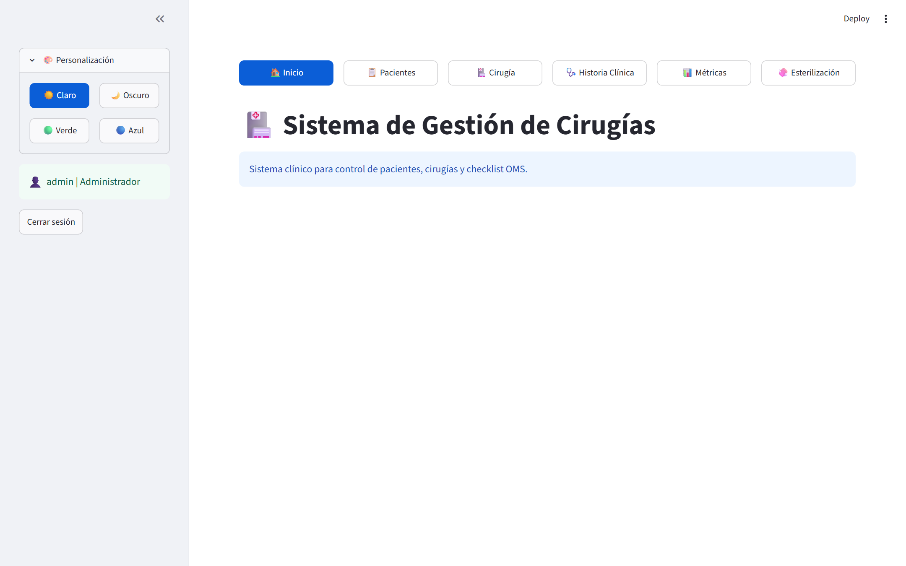
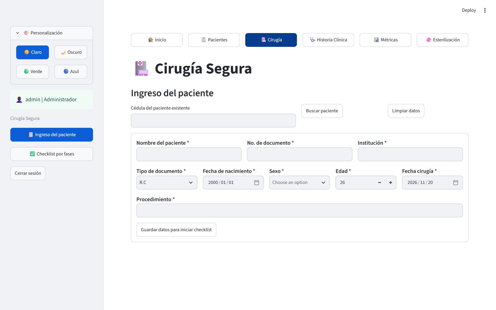
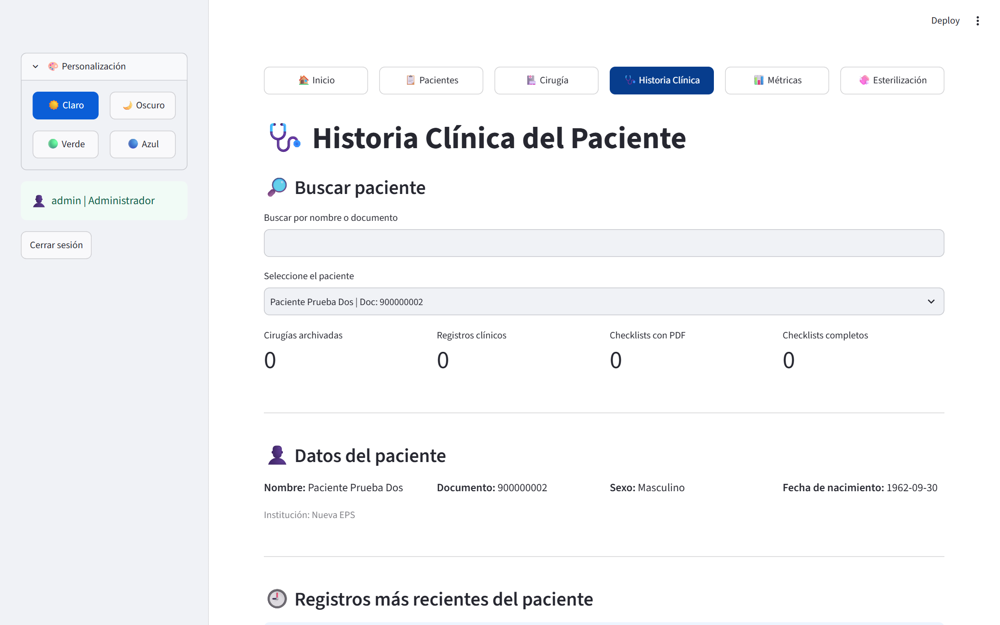
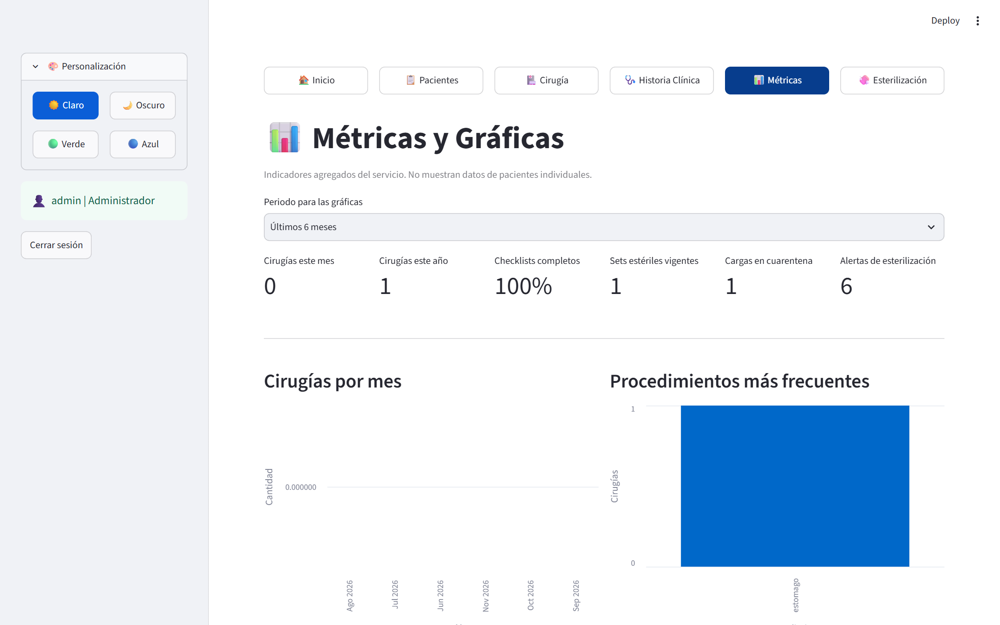
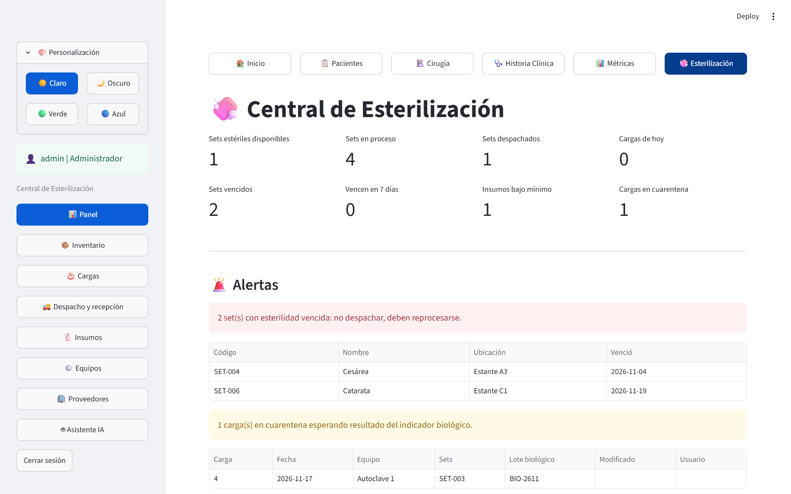
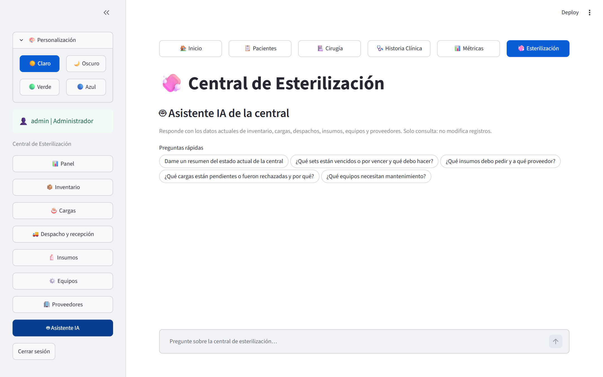

# PROPUESTA COMERCIAL
## Sistema de Gestión Quirúrgica y Central de Esterilización
### Clínica Balsalezo — Cartagena de Indias

**Versión:** 1.0 · **Fecha:** 20 de noviembre de 2026 · **Vigencia de la oferta:** 30 días

---

## 1. Resumen ejecutivo

La Clínica Balsalezo incorporará un **sistema web integral** que digitaliza tres procesos críticos del servicio quirúrgico:

- **Checklist de Cirugía Segura (OMS)** con fases preoperatoria, firmas, intraoperatoria, postoperatoria y PDF automático.
- **Historia clínica del paciente** con evoluciones y **asistente de inteligencia artificial** que responde consultas sobre la historia.
- **Central de esterilización** con inventario de sets, trazabilidad de cargas, despacho y recepción de material, insumos, equipos, proveedores y su propio asistente de IA.
- **Métricas y gráficas** para la dirección y enfermería, organizadas en paneles por área (cirugía, checklist, historia clínica y central de esterilización), con filtros por fecha, institución, procedimiento, cirujano, sexo y estado del checklist, y exportación a Excel con los gráficos incluidos.

La solución se entrega **implementada y operativa**: instalada en infraestructura propia de la clínica o en la nube, con usuarios creados, datos migrados, respaldos automáticos y personal capacitado.

---

## 2. Qué recibe la clínica

| Componente | Detalle |
|---|---|
| Aplicación web | Acceso desde cualquier navegador del quirófano, central de esterilización o consultorio. Sin instalación en los equipos del usuario. |
| Usuarios y roles | Administrador, Cirujano, Enfermería; permisos diferenciados (la central de esterilización y los parámetros son solo para administración). |
| Parámetros | Catálogos administrables desde la web: instituciones, cirujanos, procedimientos, tipos de documento, métodos de esterilización y más; se activan o desactivan sin tocar código. |
| Datos | Migración desde cero o importación de listas existentes (pacientes, proveedores, instrumental, insumos, equipos). |
| Documentos | PDF de checklist de cirugía segura con logo institucional y firmas capturadas en pantalla. |
| Inteligencia artificial | Dos asistentes con IA (historia clínica y central de esterilización), en español, basados en los datos reales del sistema. |
| Temas visuales | Claro, oscuro, verde y azul. |
| Infraestructura | Servidor (VPS o equipo en la clínica), dominio, certificado HTTPS, servicio automático, monitoreo básico. |
| Respaldos | Copia diaria cifrada con retención de 30 días y restauración probada. |
| Seguridad | Contraseñas cifradas, control de roles, registro de cambios (fecha y usuario), llaves fuera del código. |
| Capacitación | Sesión por rol (administración, cirugía, enfermería, central de esterilización) y manual de usuario. |
| Soporte | Mesa de ayuda durante el piloto y plan de soporte mensual opcional. |

---

## 3. La solución en acción

### ¿Por qué elegir esta solución?

- **Cero papel en el quirófano:** el checklist OMS se diligencia en pantalla, las firmas se capturan con el dedo o el mouse y el PDF sale en un clic.
- **Trazabilidad de extremo a extremo:** del paciente a la cirugía, del instrumental a la carga de esterilización, del despacho al quirófano y de vuelta.
- **IA que responde con los datos de la clínica:** el asistente consulta la historia clínica y la central de esterilización reales; no inventa respuestas.
- **Métricas para decidir:** la dirección filtra por fecha, cirujano, procedimiento o institución y descarga el informe en Excel con gráficos listos para presentar.
- **Datos propios y portables:** la información es de la clínica y se exporta en formatos abiertos (CSV/Excel/PDF).
- **Sin instalaciones en los equipos del usuario:** solo un navegador y conexión a internet.
- **Escalable:** crece con el servicio (más cirugías, más usuarios, más módulos) sin cambiar de sistema.
- **Implementación rápida:** de la demostración a producción en semanas, no en meses.

### Evidencia del funcionamiento

*Panel principal: una sola pantalla para todo el servicio quirúrgico.*

*Checklist de Cirugía Segura (OMS): fases preoperatoria, firmas, intraoperatoria, postoperatoria y PDF automático.*

*Historia clínica del paciente: datos, cirugías archivadas, evoluciones y asistente de IA integrado.*

*Métricas: paneles por área, filtros por fecha/cirujano/procedimiento y descarga en Excel con gráficos.*

*Central de esterilización: inventario de sets, trazabilidad de cargas, alertas y despachos.*

*Asistente IA: responde en español con los datos actuales de la central (insumos, sets, equipos, cargas).*

## 4. Alojamiento: recomendación técnica

La clínica puede elegir entre dos esquemas. **Recomendamos la opción A** para la mayoría de los casos.

### Opción A — Servidor en la nube (VPS) — RECOMENDADA
- Acceso desde cualquier lugar con internet: quirófano, casa del médico, sede alterna.
- Certificado HTTPS automático, respaldos externos automáticos, sin dependencia de un PC encendido en la clínica.
- Costo mensual predecible y bajo, sin inversión en hardware ni mantenimiento de equipos propios.

### Opción B — Servidor físico en la clínica
- Un equipo dedicado (o uno existente) aloja el sistema dentro de la red local.
- **Solo accesible desde la red de la clínica**; para entrar desde casa se requiere configurar una VPN (Tailscale/WireGuard) o acceso remoto (AnyDesk), lo cual no es práctico para uso diario de varios usuarios.
- Requiere invertir en un equipo dedicado (o reutilizar uno existente) más servicios de energía, internet y respaldo externo.
- Recomendado solo si la norma interna exige que los datos no salgan de la sede o si el internet es insuficiente.

> **Nota técnica:** AnyDesk sirve para soporte remoto puntual, no como vía de acceso web diaria para varios usuarios. Si se elige servidor local, lo correcto es una VPN (por ejemplo Tailscale, sin costo).

---

## 5. Cronograma de implementación

| Semana | Hito |
|---|---|
| 1 | Cierre técnico: limpieza de datos de prueba, secretos fuera del repositorio, definición de usuarios y roles reales. |
| 2 | Seguridad: contraseñas cifradas, permisos por rol en todo el sistema, HTTPS, auditoría de accesos. |
| 3 | Datos: migración a base de datos robusta, respaldos automáticos, prueba de restauración. |
| 4 | Infraestructura: servidor, dominio, servicio automático, monitoreo; si es local, VPN para acceso remoto. |
| 5–7 | **Piloto**: un quirófano y la central de esterilización con datos reales; capacitación por rol; lista de ajustes. |
| 8 | **Puesta en marcha**: capacitación general, entrega de manuales, acta de entrega y plan de soporte. |

---

## 6. Paso a paso de organización (hoja de ruta del proyecto)

1. **Aprobación y alcance** — la clínica define módulos prioritarios, usuarios por rol e infraestructura preferida.
2. **Preparación técnica** — limpiar el prototipo, inventario de usuarios, elegir alojamiento, registrar dominio.
3. **Seguridad** — cifrado de claves, permisos globales, HTTPS, auditoría, rotación de credenciales.
4. **Datos** — base de datos definitiva, respaldos diarios cifrados, política de retención y habeas data.
5. **Instalación** — servidor, servicio automático, firewall, monitoreo, VPN si aplica.
6. **Piloto** — operación real controlada con capacitación y bitácora de incidencias.
7. **Puesta en marcha** — capacitación total, manuales, mesa de ayuda y acta de entrega.
8. **Operación** — soporte mensual, actualizaciones, verificación de respaldos y mejora continua.

---

## 7. Condiciones

- La implementación se realiza sobre el prototipo actual; cualquier funcionalidad nueva se cotiza aparte.
- Los datos clínicos son propiedad de la clínica; se entregan exportables (CSV/Excel/PDF) en la entrega final.
- El asistente de IA es una herramienta de apoyo a la consulta; no reemplaza el juicio clínico.
- La clínica es responsable de la política de tratamiento de datos personales (habeas data) y de las autorizaciones de los pacientes.

---

## 8. Aceptación

| | Nombre | Cargo | Firma | Fecha |
|---|---|---|---|---|
| Por la clínica | | | | |
| Por el proveedor | | | | |

---

*Propuesta elaborada a partir del análisis del sistema `Cirugia_app`. Los valores de infraestructura y soporte se cotizan formalmente según la opción de alojamiento elegida por la clínica.*
